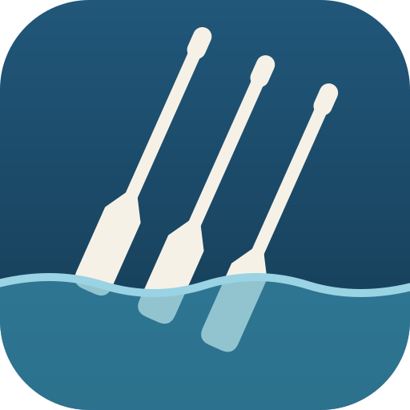
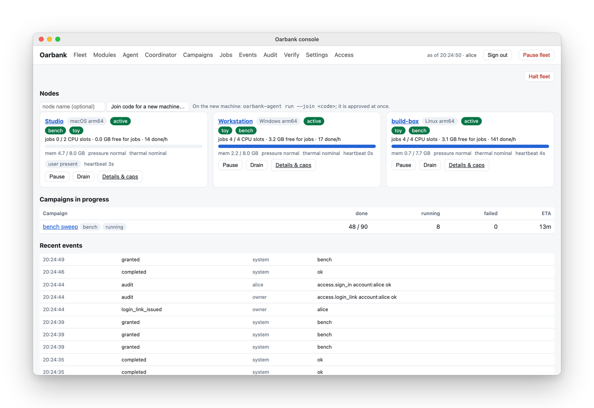
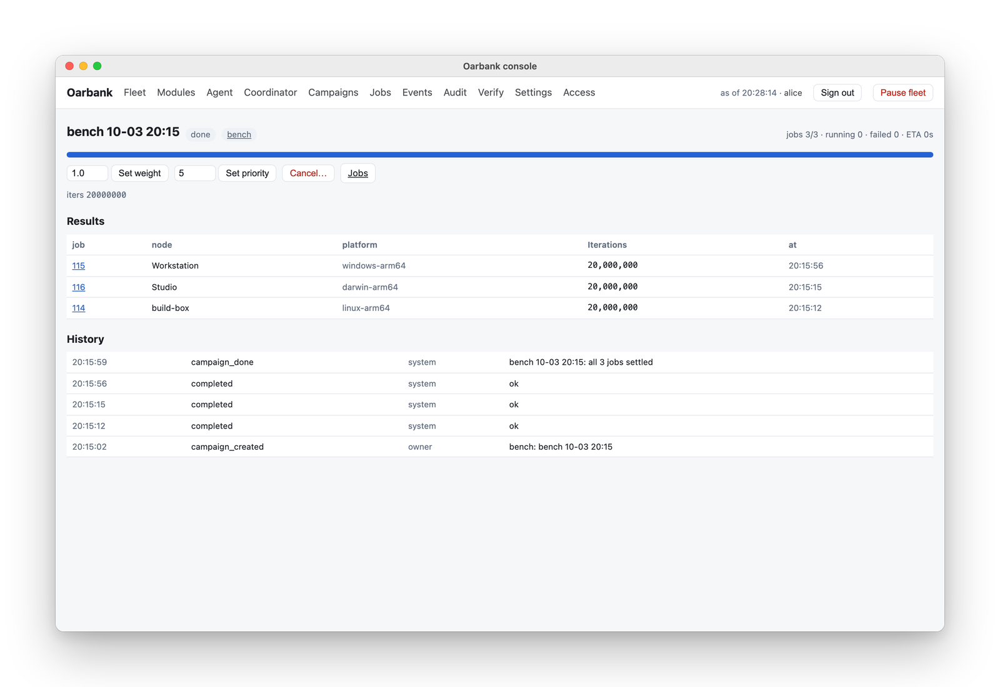
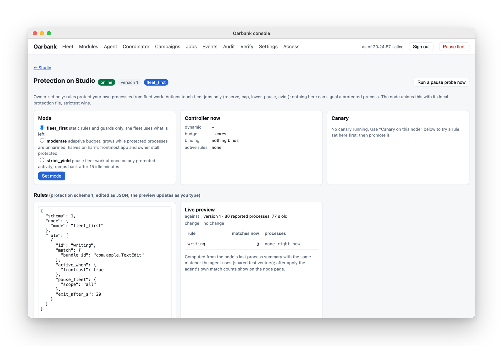
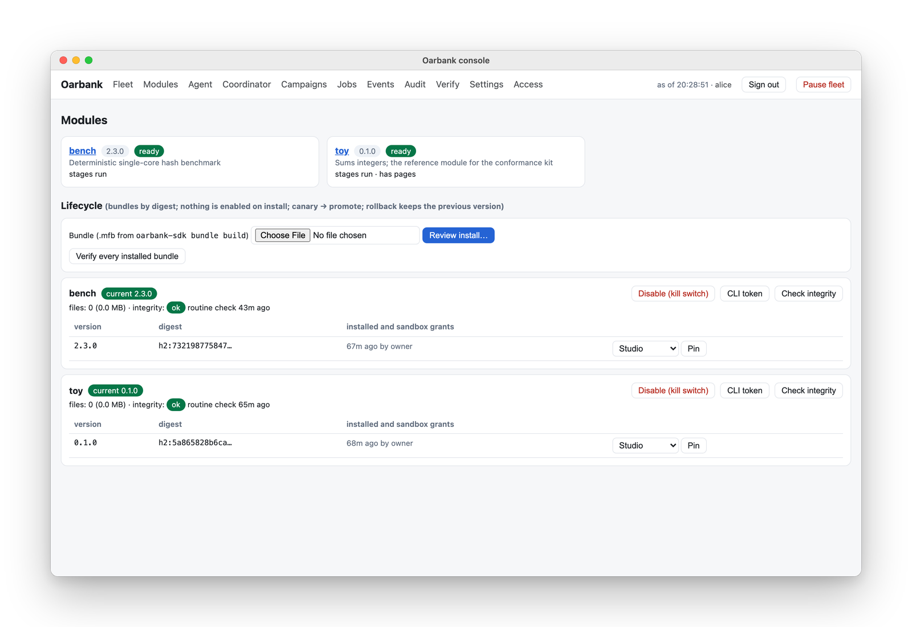
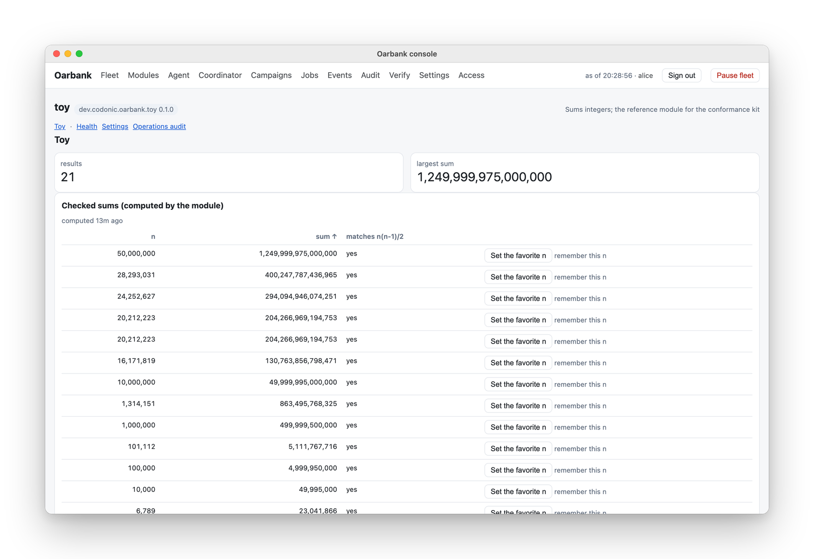

<p align="center">
  
</p>

<h1 align="center">Oarbank</h1>

<p align="center"><a href="README.md">English</a> | <a href="README.zh-CN.md">简体中文</a> | <a href="README.ja.md">日本語</a></p>

<p align="center"><b>手持ちのコンピューターにバッチジョブを分散させます。</b><br>
Mac、Linux マシン、Windows PC のためのセルフホスト型ジョブキューです。コーディネーターは 1 台、各コンピューターにノードを 1 つ置き、持ち主自身の作業を優先し、すべてのジョブを OS のサンドボックスで実行します。</p>

<p align="center"><sub><b>ソースアベイラブルであり、オープンソースではありません：</b><a href="LICENSE.md">PolyForm Strict 1.0.0</a> のもと、個人利用および非商用利用は無料です。商用利用にはライセンスが必要です（<a href="#licence">後述</a>）。<a href="https://github.com/roeehrl/oarbank-sdk">モジュール SDK</a> は Apache-2.0 のオープンソースです。</sub></p>

<p align="center">
  <a href="https://github.com/roeehrl/oarbank/actions/workflows/ci.yml"></a>
  <a href="LICENSE.md"></a>
  <a href="https://github.com/roeehrl/oarbank-sdk"></a>
  
</p>

<p align="center">
  ドキュメント（英語）：
  <a href="https://docs.codonic.dev/oarbank/">トップ</a> ·
  <a href="https://docs.codonic.dev/oarbank/get-started">はじめに</a> ·
  <a href="https://docs.codonic.dev/oarbank/concepts/how-oarbank-works">仕組み</a> ·
  <a href="https://docs.codonic.dev/oarbank/build/tutorial">モジュールを作る</a> ·
  <a href="https://docs.codonic.dev/oarbank/operate/troubleshooting">トラブルシューティング</a> ·
  <a href="https://codonic.dev/apps/oarbank">製品ページ</a>
</p>

<p align="center">
  <a href="https://codonic.dev/apps/oarbank">
    <picture>
      <source media="(prefers-color-scheme: dark)" srcset="docs/assets/hero-fleet-dark.png">
      
    </picture>
  </a>
  <br>
  <sub>架空のデモ用フリートを表示したコンソール。<a href="https://codonic.dev/apps/oarbank#inside">20 秒のクリップを codonic.dev で見る</a>。</sub>
</p>

> この文書は英語版 README の翻訳で、参考情報です。**[英語版 README](README.md) が正式かつ最新の版**であり、内容に違いがある場合は英語版が優先されます。ライセンス条件については、英語の [LICENSE.md](LICENSE.md) だけが法的拘束力を持つ正文です。長い解説的な節は要約のみとし、英語版の該当箇所へのリンクを付けています。

> **リリース 2.11.1**（2.11.0 の修正リリース）を公開しました。2.11 では、ノードがコンテナ VM をいつ動かすか（`always`、`on_demand`、`off`）とその規模を指定できるようになり、マシンを承認する際に開始時の状態、モジュール、設定を指定できるようになりました。また、モジュールがノードから外れた後にそのノードに残したものを削除でき、退役したノードのエージェントは再参加せずに停止するようになりました。2.10 で加わったインターネット公開型のモジュール、長時間稼働するワークロード、コテナンシー（co-tenancy）証明書の上に構築されています。アップグレード時の変更点は[変更履歴](CHANGELOG.md)を参照してください。インストーラー（Apple シリコンと Intel 向けの macOS pkg、deb と rpm、Windows MSI）、ワンライナーのインストーラー、コーディネーター用のネイティブインストーラーは[リリースページ](https://github.com/roeehrl/oarbank/releases/tag/v2.11.1)にあります。セットアップの手順は[はじめに](https://docs.codonic.dev/oarbank/get-started)で説明しています。

<a id="what-it-does"></a>

## できること

- **すべてのコンピューターで 1 つのキューを動かします。** Mac、Linux マシン、Windows PC 上のコーディネーターが、macOS（Apple シリコンと Intel）、Linux（x86_64 と arm64、systemd、glibc 2.39 以降）、Windows 10 と 11（x64 と ARM64）のノードにジョブを配ります。ジョブは必要な CPU、メモリ、ツールを備えたノードに渡され、スリープしたり離脱したりしたノードは担当していた作業を返します。
- **各コンピューター自身の作業を優先します。** すべてのノードにメモリガードがあり、コア数、メモリ、ジョブ数、稼働時間の上限をノードごとに設定できます。いずれも設定するまではオフです。さらにノードは、誰かがコンピューターを使っている間は受け取るジョブを減らし、指定したアプリやプロセスに関するルールに従い、バッテリー駆動時や、macOS と Linux では高温時にも処理を控えます。
- **すべてのジョブをサンドボックスで実行します。** macOS では Seatbelt、Linux では Landlock と seccomp、Windows では AppContainer を使います。ジョブは自分の入力を読み、自分のフォルダーに書き込み、そのモジュールのバージョンに対してあなたが承認したネットワークホスト、ホストツール、GPU、コンテナにだけアクセスできます。
- **ノードを認定してから結果を採用します。** ノードはまず各モジュールの doctor（自己診断）とゴールデンジョブ（答えが分かっているジョブ）を実行します。他のノード上のレプリカが結果のずれたノードを検出し、応答が途絶えていたノードが古い答えを提出することもできません。
- **あらゆる種類のバッチ処理をモジュールとして実行します。** パラメータースイープ、シミュレーション、レンダリング、ベンチマーク、テストマトリクスなどです。モジュールはオープンソースの [Oarbank SDK](https://github.com/roeehrl/oarbank-sdk)（Apache-2.0）で作るバンドルで、独自のコンソールページを持ちます。
- **長時間動く処理も実行できます。** モジュールのワークロードはノードに割り当てるデーモンで、ID ごとに 1 つのシートを持ち、インターネットからの接続も受け付けられます。ノードがルーターのポートを自分で開き、外部から到達できるかを確認します。
- **あなたの指示にだけ従います。** ノードはコーディネーターの鍵をピン留めする参加コードで参加し、相互 TLS でコーディネーターと通信します。リリース、エージェントの更新、コーディネーターの移行にはオーナーであるあなたの署名が必要で、すべての変更は監査されるオペレーションになります。

### キャンペーンを開始すると、そのジョブがすべてのノードに分散します

<picture>
  <source media="(prefers-color-scheme: dark)" srcset="docs/assets/campaign-dark.png">
  
</picture>

キャンペーン（campaign）は、まとめて開始する一連のジョブです。コンソールからでも `oarbank` からでも開始できます。コーディネーターは各ジョブを、空きがあり認定済みのノードにリース（lease）し、誰が何を実行したかを記録します。

### 大事なアプリを指定すれば、フリートの作業が道を譲ります

<picture>
  <source media="(prefers-color-scheme: dark)" srcset="docs/assets/protection-dark.png">
  
</picture>

ホスト保護はオーナーがノードごとに設定するもので、モジュールがそれを緩めることは決してできません。作用するのはフリート自身のジョブだけで（予約、上限設定、優先度の引き下げ、一時停止、退去）、あなたのプロセスにシグナルを送れる仕組みは一切含まれていません。macOS、Linux、Windows で動作し、ルールはパス、名前、引数で（macOS ではコード署名の ID やアプリバンドルでも）あなたのプロセスを照合します。それらの CPU、メモリ、GPU の使用量や最前面のアプリをきっかけに発動し、誰かがマシンを使っている間はフリートの作業を退かせます。

### モジュールをインストールし、権限を承認し、1 台のノードで認定してから昇格させる

<picture>
  <source media="(prefers-color-scheme: dark)" srcset="docs/assets/modules-dark.png">
  
</picture>

インストールしただけでは何も有効になりません。バンドルのサンドボックス権限を確認し、1 台のノードで試し（カナリア）、それからフリート全体に昇格させます。ロールバックでは以前のバージョンが保持されます。

### モジュールは独自のコンソールページを持ち込めます

<picture>
  <source media="(prefers-color-scheme: dark)" srcset="docs/assets/module-page-dark.png">
  
</picture>

SDK の UI コントラクトにより、モジュールはコアに手を加えずに、コンソールにページ、パネル、アクションを追加できます。上の参照モジュール `toy` は整数を合計し、それぞれの答えを検算します。

<a id="install"></a>

## インストール

[2.11.1 リリース](https://github.com/roeehrl/oarbank/releases/tag/v2.11.1)からお使いのコンピューター用のパッケージをダウンロードし、[動作要件](https://docs.codonic.dev/oarbank/operate/requirements)を確認したうえで、[はじめに](https://docs.codonic.dev/oarbank/get-started)または [docs/install.md](docs/install.md) の手順に従ってください。パッケージを自分でビルドする場合、エージェント用は `scripts/package-macos.sh`、`scripts/package-linux.sh`、`scripts/package-windows.ps1`、コーディネーター用は `build-coordinator` の後に `package-coordinator` を実行します（[docs/install.md](docs/install.md) を参照）。

お使いのプラットフォーム向けのコーディネーターパッケージ（`.pkg`、`.deb`/`.rpm`、`.msi`）をインストールします。「アプリケーション」フォルダーまたはアプリケーションメニューから **Oarbank Coordinator** を開きます（Windows ではスタートメニューの **Oarbank Coordinator**）。メニューバーまたはトレイのアイコンをクリックし、**Open web app** を選びます。ブラウザーのウィザードが、ノードから到達できるアドレスと、管理者の名前とパスワードを尋ねます。表示された QR コードを認証アプリで読み取り、現在の 6 桁のコードを入力します。保留中のセットアップを開き直した場合はアドレスとアカウントが保存されているので、最初に設定したパスワードを入力すれば続けられます。ウィザードはプライマリとバックアップのオーナー署名鍵を作成してピン留めします。パッケージをインストールしただけでは、フリートの構成や起動は行われません。

セットアップ後、コンソールを開き、**Fleet** ページで **Add machine…** を選びます。参加コードが作成され、OS ごとにダウンロードするインストーラーと実行するコマンドが表示されます。コーディネーターのコンピューターにもジョブを実行させたい場合は、そこにもノードが必要です。

各コンピューターにノードパッケージ（macOS pkg、deb または rpm、Windows MSI）をインストールします。インストール中に何かを尋ねられることはありません。次に、デスクトップへのインストール後に開く **Oarbank Node** にコードを貼り付けるか、SSH 経由で `sudo oarbank-node join` を実行します。MDM、Intune、Ansible で展開する場合は、管理ポリシーを通じてコードを渡します。ノードはコードが指すコーディネーターが本当にあなたのものであることを確認してから参加し、リリースをインストールし、各モジュールの doctor とゴールデンジョブを実行して、作業を受け付け始めます。

**AI エージェントと一緒に使う。** [Oarbank skill](https://github.com/roeehrl/oarbank-sdk/tree/main/skills/oarbank) を使うと、Claude Code、Codex などのコーディングエージェントが、インストール、実行、トラブルシューティング、モジュール作成を手伝ってくれます。エージェントは最新のドキュメントを読み、何かを変更する前に確認を求めます。`npx skills add roeehrl/oarbank-sdk --skill oarbank -g` を実行するか、`oarbank@codonic` プラグインを使ってください。各エージェントの手順は [Use Oarbank with an AI agent](https://docs.codonic.dev/oarbank/get-started#use-oarbank-with-an-ai-agent)（英語）にあります。

<a id="how-it-works"></a>

## 仕組み

コーディネーターでは `oarbankd`（状態、リースとフェンシング、ディスパッチ、ゴールデンジョブによる認定、キャンペーン、モジュールストア、エージェントの相互 TLS 用の内部 CA、ハッシュチェーンの監査ログを持つ管理 API、アカウント、アラート）と、読み取り専用のブラウザーコンソール `oarbank-console` が動きます。各ノードでは Rust 製の `oarbank-agent`（エージェント）と `oarbank-launcher` が動き、コマンドラインツール `oarbank` はどこからでも使えます。ノードがコーディネーターに作業を取りに行く方式で、コーディネーターがノードに入り込むことはありません。エージェントはコーディネーター経由で自身を更新し、まず 1 台のノードから適用され、10 分以内に正常に起動しなかったビルドは自動的にロールバックされます。コーディネーター自体も別のコンピューターに移行でき、すべてのノードがその移行を検証して追従します。構成要素の表と詳細は、英語版の [How it works](README.md#how-it-works) と、[docs/design/architecture.md](docs/design/architecture.md)、[docs/protocol.md](docs/protocol.md)、[docs/release-signing.md](docs/release-signing.md)、[docs/verification.md](docs/verification.md) を参照してください。

<a id="how-it-treats-your-data"></a>

## データの扱い

- **経路上に Codonic のサービスはなく、アカウントも、テレメトリも、クラッシュレポートもありません。** Oarbank はあなたのコンピューターとネットワーク（LAN、Tailscale、ZeroTier、任意の VPN）の上で動きます。
- **データは実行している場所にとどまります。** コーディネーターはデータベース、アカウント、モジュールストア、結果、ログを自分のコンピューターに保存し、各ノードは鍵、キャッシュ、ジョブフォルダーを自分自身に保存します。
- **ノードがコーディネーターに送るのは、スケジューリングに必要な情報だけです**：ハードウェア情報、負荷、ホスト保護の判断、ジョブの結果です。コーディネーターはノードが見つけられるようにローカルネットワーク上で自身を告知しますが、これはオフにできます。
- **インターネットに接続するのは、あなたが指定した先だけです**：モジュールに対して承認したホストとコンテナイメージ（そのサンドボックス内から使用）、登録したデータセットの取得元、コーディネーター移行のためのレスキュー用の場所、そして通知を有効にした場合の通知サーバーです。

<a id="why-not"></a>

## なぜ…ではないのか

| | 得意なこと | それでも Oarbank を選ぶ理由 |
|---|---|---|
| **GNU parallel / ssh ループ** | セットアップ不要。使っていないマシンで一度きりのバッチを流すには最適 | 各マシン自身の負荷に合わせたスケジューリングがなく、マシンをまたいだリトライや結果の検証もなく、Windows ノードも使えない |
| **Ray** | Python ネイティブの分散コンピューティング。ノート PC から大規模クラスターまで | クラスターが前提：人が作業しているマシンを守るホスト保護がなく、コードも Ray 向けに書く必要がある。Oarbank は既存のプログラムをモジュールとして実行する |
| **HTCondor / BOINC** | キャンパスやボランティアコンピューティング向けの、実績ある遊休リソース活用。非常に大規模に対応 | 組織向けに作られており、数台の個人マシンにはセットアップも運用も重い |
| **Slurm / Nomad** | データセンターやサーバーのスケジューリング | 専用サーバーが前提で、「いま誰かがこのコンピューターを使っている」という概念がない |
| **Celery / RQ** | 自分のアプリケーション内のタスクキュー | ブローカーとワーカーを自分で動かし、タスクも自分で書く。サンドボックスもノードの認定もない |
| **クラウドバッチ**（AWS Batch など） | オンデマンドで伸縮する計算能力 | 時間単位で費用がかかり、データが手元のマシンから出ていく |

Oarbank が向いているのは、あなたが所有し実際に使っている **2 台から 20 台程度の混在したコンピューター**で、独立したジョブに分割できる作業を実行する場合です。専用サーバーですでにクラスタースケジューラーを運用しているなら、それを使い続けてください。

<a id="faq"></a>

## よくある質問

**今すぐインストールできますか？** はい。[2.11.1 リリース](https://github.com/roeehrl/oarbank/releases/tag/v2.11.1)に macOS、Linux、Windows 用のインストーラーがあります。動作要件と手順は[はじめに](https://docs.codonic.dev/oarbank/get-started)にあります。

**何が必要ですか？** 互いに通信できる 2 台以上のコンピューターです。コーディネーター用に Mac、Linux マシン、Windows PC のいずれか 1 台（ノードを兼ねることもできます）と、ノードとして使う Mac、Linux マシン、Windows PC が必要です。

**コンピューターが遅くなりませんか？** そうならないように作られています。空きメモリが少なくなるとメモリガードがジョブの受け付けを止め、さらに減り続ける場合はフリートのジョブを退去させます。上限設定でコア数、メモリ、ジョブ数、稼働時間を制限することもできます。さらに、macOS、Linux、Windows のいずれでも、コンピューターを使っている人や指定したアプリに道を譲ります。

**ジョブが私のファイルを読むことはできますか？** できません。すべてのジョブは OS のサンドボックス内で動き、読めるのは自分の入力とモジュールだけ、書き込めるのは自分のフォルダーだけです。ネットワークホスト、ホストツール、GPU、コンテナは、モジュールのバージョンごとにあなたが承認する権限です。コンテナはエージェント自身のランタイム（macOS では Colima VM、Linux では rootless Podman、Windows では WSL のコンテナセッション）で動き、ジョブのフォルダーしか見えません。

**ジョブの途中でノードがオフラインになったらどうなりますか？** そのリースが期限切れになり、コーディネーターがジョブを別のノードに渡します。失われたリースからの答えは採用されません。

**オープンソースですか？** いいえ。コアは PolyForm Strict 1.0.0 のもとで提供されるソースアベイラブルなソフトウェアです。すべてのコードを読み、実行し、監査できますが、販売はできず、コントリビューション以外の目的で改変や再配布をすることもできません。[SDK](https://github.com/roeehrl/oarbank-sdk) は Apache-2.0 のオープンソースなので、誰でもモジュールを作成、改変、共有できます。

**誰が無料で使えますか？** 商用への応用を見込まない個人利用（趣味のプロジェクト、ホームラボ、学習、公共の知識のための研究）であれば誰でも無料で使えます。また、慈善団体、学校や大学、公的研究機関、政府機関は、資金源にかかわらず無料で使えます。正確な条件は[ライセンス](LICENSE.md)（英語の原文が正文）を参照してください。

**会社で使えますか？** はい。Codonic の商用ライセンスが必要です。support@codonic.dev までご連絡ください。

<a id="contributing"></a>

## コントリビューション

Issue とプルリクエストを歓迎します。まず [CONTRIBUTING.md](CONTRIBUTING.md) を読んでください。そこでは、コントリビューションを目的としたフォークとコードの改変が許諾されています。また、最初のプルリクエストにコメントすることで、[コントリビューターライセンス契約](CLA.md)に一度だけ署名していただきます（作品の著作権はあなたが保持します）。小さな修正より大きな変更は、先に Issue を立ててください。セキュリティ上の問題は公開の Issue ではなく、[Security タブ](https://github.com/roeehrl/oarbank/security/advisories/new)または support@codonic.dev に報告してください。詳しくは [SECURITY.md](SECURITY.md) を参照してください。

```bash
uv sync --extra dev
uv run pytest --ignore=tests/rust            # coordinator: unit, HTTP, console, protection, modules, simulation
(cd rust && cargo test --workspace)          # agent, launcher and protection crates
uv run pytest tests/rust                     # the agent end to end against real oarbankd processes
```

新しい種類の処理はコアではなくモジュールとして作ってください。まず SDK の[チュートリアル](https://docs.codonic.dev/oarbank/build/tutorial)から始め、`oarbank-sdk conform` でモジュールをチェックしてください。

<a id="licence"></a>

## ライセンス

Oarbank のコアは [PolyForm Strict License 1.0.0](LICENSE.md) のもとで提供される**ソースアベイラブル**なソフトウェアで、個人利用および非商用利用は無料です。商用利用には Codonic からのライセンスが必要です。support@codonic.dev までご連絡ください。[モジュール SDK](https://github.com/roeehrl/oarbank-sdk) は **Apache License 2.0** のオープンソースです。

この節の翻訳は参考用です。法的拘束力を持つのは英語の [LICENSE.md](LICENSE.md) です。

Oarbank および Oarbank のロゴは Codonic Dev, LLC の商標です。macOS、Windows その他の製品名は各所有者の商標であり、互換性を説明する目的でのみ記載しています。
