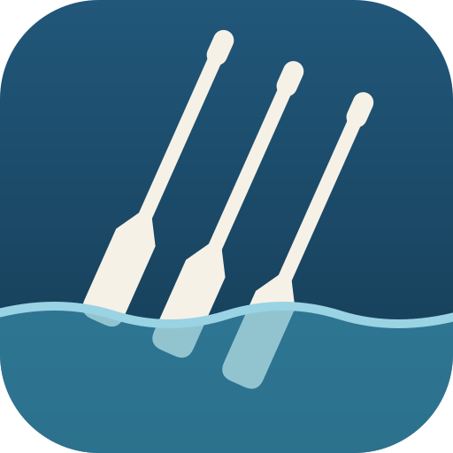
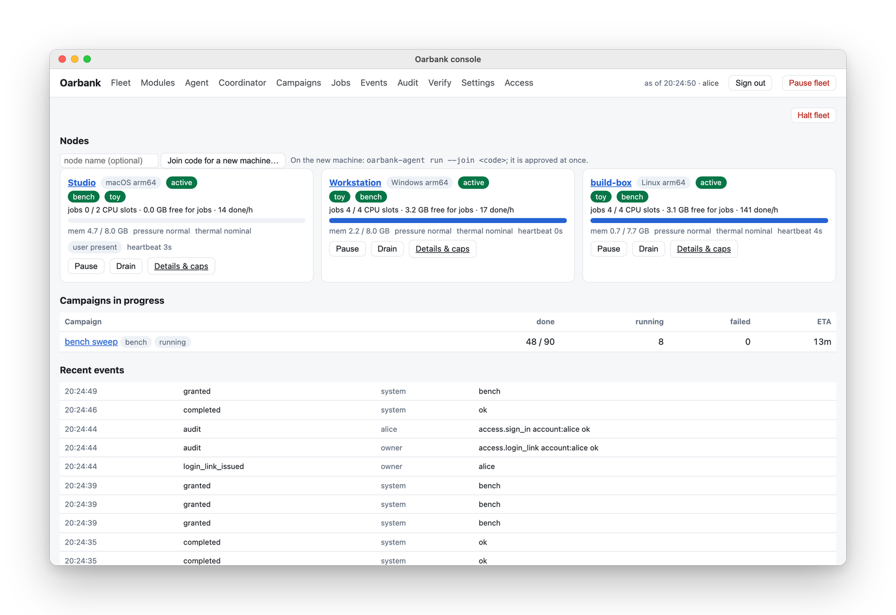
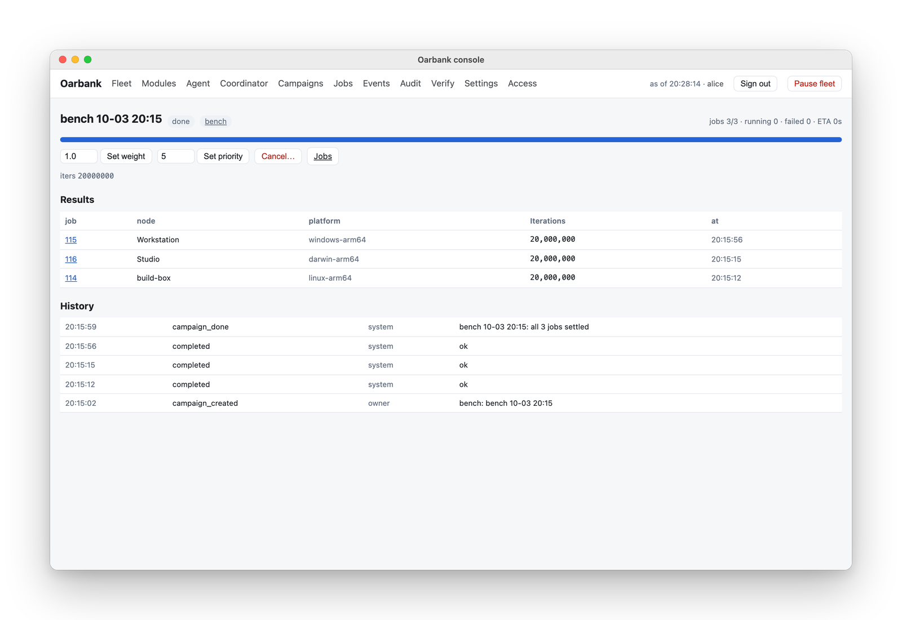
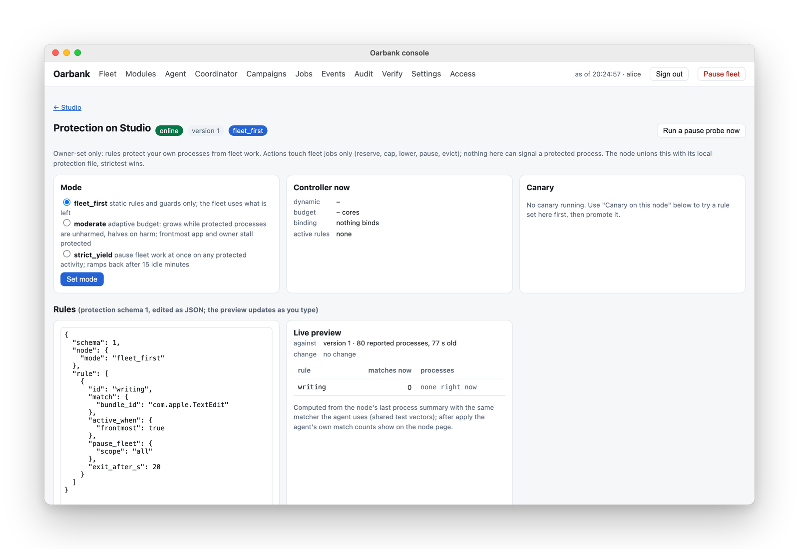
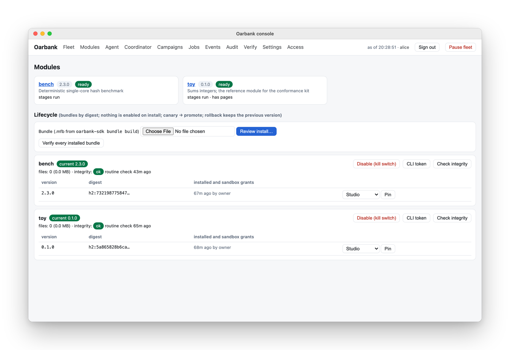
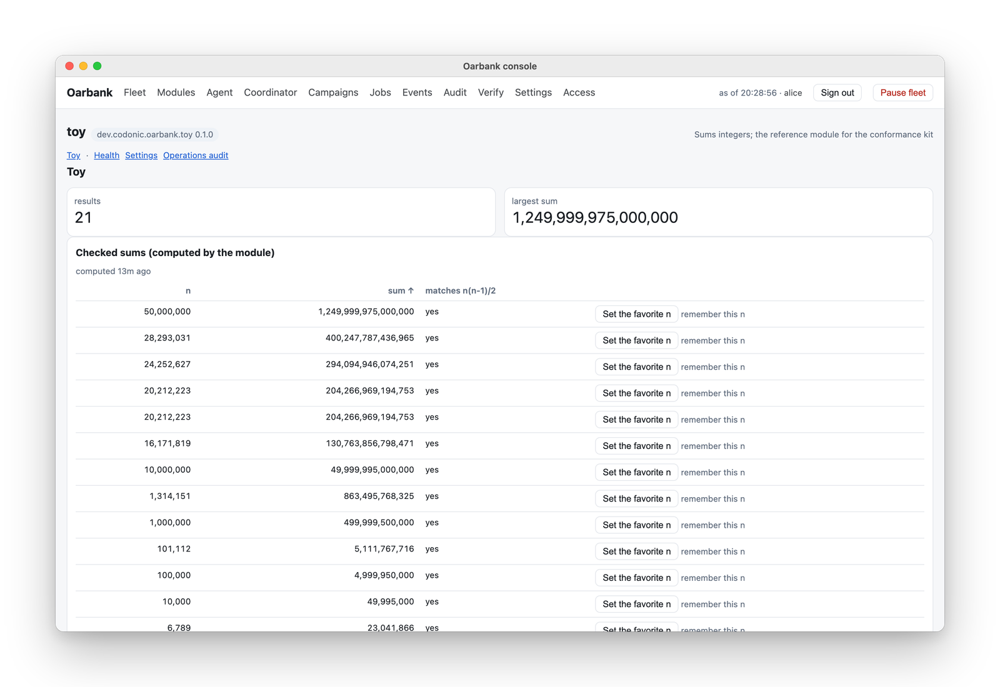

<p align="center">
  
</p>

<h1 align="center">Oarbank</h1>

<p align="center"><a href="README.md">English</a> | <a href="README.zh-CN.md">简体中文</a> | <a href="README.ja.md">日本語</a></p>

<p align="center"><b>把批处理作业分摊到你已有的电脑上。</b><br>
一个自托管的作业队列，适用于你的 Mac、Linux 机器和 Windows PC：一台协调器，每台电脑上一个节点，电脑主人自己的工作优先，每个作业都在操作系统的沙箱中运行。</p>

<p align="center"><sub><b>源码可见，而非开源软件：</b>依据 <a href="LICENSE.md">PolyForm Strict 1.0.0</a>，个人和非商业用途免费；商业用途需要获得许可（<a href="#licence">见下文</a>）。<a href="https://github.com/roeehrl/oarbank-sdk">模块 SDK</a> 依据 Apache-2.0 开源。</sub></p>

<p align="center">
  <a href="https://github.com/roeehrl/oarbank/actions/workflows/ci.yml"></a>
  <a href="LICENSE.md"></a>
  <a href="https://github.com/roeehrl/oarbank-sdk"></a>
  
</p>

<p align="center">
  文档（英文）：
  <a href="https://docs.codonic.dev/oarbank/">文档首页</a> ·
  <a href="https://docs.codonic.dev/oarbank/get-started">快速上手</a> ·
  <a href="https://docs.codonic.dev/oarbank/concepts/how-oarbank-works">工作原理</a> ·
  <a href="https://docs.codonic.dev/oarbank/build/tutorial">构建模块</a> ·
  <a href="https://docs.codonic.dev/oarbank/operate/troubleshooting">故障排查</a> ·
  <a href="https://codonic.dev/apps/oarbank">产品页面</a>
</p>

<p align="center">
  <a href="https://codonic.dev/apps/oarbank">
    <picture>
      <source media="(prefers-color-scheme: dark)" srcset="docs/assets/hero-fleet-dark.png">
      
    </picture>
  </a>
  <br>
  <sub>控制台，使用虚构的演示机群。<a href="https://codonic.dev/apps/oarbank#inside">在 codonic.dev 观看 20 秒短片</a>。</sub>
</p>

> 本文是英文 README 的翻译，仅供参考。**[英文 README](README.md) 是权威且最新的版本**；如有出入，以英文版为准。许可条款仅以英文 [LICENSE.md](LICENSE.md) 为准，只有英文文本具有约束力。较长的参考章节在这里只做了概述，并附有指向英文原文的链接。

> **2.11.1 版**已发布，这是 2.11.0 的修复版本。2.11 让你可以设定节点何时运行其容器虚拟机（`always`、`on_demand` 或 `off`）以及虚拟机的规格；批准一台机器时，可以一并指定它启动时的状态、模块和设置；模块离开某个节点后，可以删除它在该节点上留下的内容；已退役节点的代理程序会停止运行，而不会再次加入。它建立在 2.10 的面向互联网的模块、长期运行的工作负载和共租（co-tenancy）证书之上。升级时会有哪些变化，请参见[更新日志](CHANGELOG.md)。安装包（适用于 Apple 芯片和 Intel 的 macOS pkg、deb 和 rpm、Windows MSI）、一行命令安装脚本以及协调器原生安装包都在[发布页面](https://github.com/roeehrl/oarbank/releases/tag/v2.11.1)上。[快速上手](https://docs.codonic.dev/oarbank/get-started)会带你完成设置。

<a id="what-it-does"></a>

## 功能

- **在你所有的电脑上运行同一个队列。** 协调器可以运行在 Mac、Linux 机器或 Windows PC 上，把作业分发给运行 macOS（Apple 芯片和 Intel）、Linux（x86_64 和 arm64，systemd，glibc 2.39+）以及 Windows 10 和 11（x64 和 ARM64）的节点。作业会交给具备所需 CPU、内存和工具的节点；节点休眠或离开时，会把手上的工作交还回来。
- **优先保证每台电脑自己的工作。** 每个节点都有内存保护，并可以按节点限制核心数、内存、作业数和运行时长，这些限制在你设置之前都处于关闭状态。有人在使用电脑时，节点也会少接作业；它还会遵循你为指定的应用和进程设定的规则，在使用电池时让步，在 macOS 和 Linux 上温度过高时也会让步。
- **每个作业都在沙箱中运行。** macOS 上使用 Seatbelt，Linux 上使用 Landlock 和 seccomp，Windows 上使用 AppContainer。作业只能读取自己的输入、写入自己的文件夹，并且只能访问你为该模块版本批准的网络主机、主机工具、GPU 和容器。
- **节点通过认证后，其结果才算数。** 节点会先运行每个模块的 doctor 自检和黄金作业（已知答案的作业）。其他节点上的副本能发现结果出现偏差的节点，失联过的节点也无法交回过期的答案。
- **任何批处理工作都可以作为模块运行。** 参数扫描、仿真、渲染、基准测试、测试矩阵都可以。模块是用开源的 [Oarbank SDK](https://github.com/roeehrl/oarbank-sdk)（Apache-2.0）构建的软件包，带有自己的控制台页面。
- **也能运行长期工作。** 模块工作负载是一个分配给节点的守护进程，每个身份占一个席位，并且可以接受来自互联网的连接：节点会自己在路由器上打开端口，并从外部检查它是否可达。
- **只听命于你。** 节点使用加入码加入，加入码锁定（pin）了你的协调器的密钥；节点与协调器之间通过双向 TLS 通信。发布版本、代理程序更新和协调器迁移都需要你作为所有者签名，每一项变更都是一次经过审计的操作。

### 启动一个作业批次，它的作业会分散到每个节点

<picture>
  <source media="(prefers-color-scheme: dark)" srcset="docs/assets/campaign-dark.png">
  
</picture>

作业批次（campaign）是你一起启动的一组作业，可以在控制台中启动，也可以用 `oarbank` 启动。协调器把每个作业租给（lease）一个有空余容量且已通过认证的节点，并记录谁运行了什么。

### 指定重要的应用，机群工作就会让路

<picture>
  <source media="(prefers-color-scheme: dark)" srcset="docs/assets/protection-dark.png">
  
</picture>

主机保护由所有者按节点设置，模块永远无法放宽它。它只会作用于机群自己的作业（预留、限额、降低优先级、暂停、驱逐）；其中没有任何机制能向你自己的进程发送信号。它可以在 macOS、Linux 和 Windows 上运行：规则按路径、名称或参数匹配你的进程（在 macOS 上还可以按代码签名身份或应用包匹配），由这些进程的 CPU、内存或 GPU 占用或者前台应用触发，并在有人使用这台机器时让机群工作让路。

### 安装模块，批准它的授权，在一个节点上认证，然后推广

<picture>
  <source media="(prefers-color-scheme: dark)" srcset="docs/assets/modules-dark.png">
  
</picture>

安装时不会启用任何内容。你先审查软件包的沙箱授权，在一个节点上试用（金丝雀），然后推广到整个机群；回滚时会保留上一个版本。

### 模块自带控制台页面

<picture>
  <source media="(prefers-color-scheme: dark)" srcset="docs/assets/module-page-dark.png">
  
</picture>

SDK 的 UI 约定让模块无需改动核心，就能向控制台添加页面、面板和操作。上面的参考模块 `toy` 对整数求和，并检查每个答案。

<a id="install"></a>

## 安装

从 [2.11.1 版本](https://github.com/roeehrl/oarbank/releases/tag/v2.11.1)下载适合你电脑的安装包，查看[系统要求](https://docs.codonic.dev/oarbank/operate/requirements)，然后按照[快速上手](https://docs.codonic.dev/oarbank/get-started)或 [docs/install.md](docs/install.md) 操作。如果要自己构建安装包：代理程序使用 `scripts/package-macos.sh`、`scripts/package-linux.sh`、`scripts/package-windows.ps1`；协调器先运行 `build-coordinator`，再运行 `package-coordinator`（参见 [docs/install.md](docs/install.md)）。

为你的平台安装协调器安装包（`.pkg`、`.deb`/`.rpm` 或 `.msi`）。从“应用程序”文件夹或应用菜单中打开 **Oarbank Coordinator**（在 Windows 的“开始”菜单中同样是 **Oarbank Coordinator**）。点击它的菜单栏图标或托盘图标，选择 **Open web app**。浏览器中的设置向导会询问节点将要访问的地址，以及你的管理员用户名和密码。用身份验证器扫描显示的二维码，然后输入它当前的六位验证码。如果你重新打开尚未完成的设置，地址和账号都已保存，输入原来的密码即可继续。向导会创建并锁定你的主所有者签名密钥和备用所有者签名密钥。仅安装软件包并不会配置或启动机群。

设置完成后，打开控制台，在 **Fleet** 页面上选择 **Add machine…**。它会生成一个加入码，并针对每种操作系统显示要下载的安装程序和要运行的命令。如果你希望协调器所在的电脑也执行作业，也需要在上面安装一个节点。

在每台电脑上安装节点安装包（macOS pkg、deb 或 rpm，或 Windows MSI）；安装过程中不会询问任何问题。然后把加入码粘贴到 **Oarbank Node** 中（桌面安装完成后会自动打开），或者通过 SSH 运行 `sudo oarbank-node join`。使用 MDM、Intune 或 Ansible 部署时，则通过托管策略提供加入码。节点会确认加入码对应的协调器确实是你的，然后加入、安装它的发布版本、运行每个模块的 doctor 自检和黄金作业，并开始接收工作。

**借助 AI 智能体。** [Oarbank skill](https://github.com/roeehrl/oarbank-sdk/tree/main/skills/oarbank) 让 Claude Code、Codex 和其他编程智能体帮你安装、运行、排查故障和构建模块；它们会阅读最新文档，并在做任何更改之前征求你的同意：`npx skills add roeehrl/oarbank-sdk --skill oarbank -g`，或者使用 `oarbank@codonic` 插件。每个智能体的具体步骤见 [Use Oarbank with an AI agent](https://docs.codonic.dev/oarbank/get-started#use-oarbank-with-an-ai-agent)（英文）。

<a id="how-it-works"></a>

## 工作原理

协调器上运行 `oarbankd`（状态、租约、调度、用黄金作业做认证、作业批次、模块商店、供代理程序双向 TLS 使用的内部 CA、带哈希链审计日志的管理 API、账号和告警）以及只读的浏览器控制台 `oarbank-console`；每个节点上运行用 Rust 编写的 `oarbank-agent`（代理程序）和 `oarbank-launcher`；命令行工具 `oarbank` 可以在任何地方使用。节点主动向协调器请求工作，协调器从不主动进入节点。代理程序通过你的协调器自行更新，先更新一个节点，十分钟内未能健康启动的版本会自动回滚。协调器本身也可以迁移到你的另一台电脑，每个节点都会验证这次迁移并跟随过去。组件表和更多细节见英文版的 [How it works](README.md#how-it-works)，以及 [docs/design/architecture.md](docs/design/architecture.md)、[docs/protocol.md](docs/protocol.md)、[docs/release-signing.md](docs/release-signing.md) 和 [docs/verification.md](docs/verification.md)。

<a id="how-it-treats-your-data"></a>

## 如何对待你的数据

- **中间不经过任何 Codonic 服务，不需要账号，没有遥测，也没有崩溃报告。** Oarbank 运行在你的电脑和你的网络上：局域网、Tailscale、ZeroTier 或任何 VPN。
- **你的数据留在你运行它的地方。** 协调器把数据库、账号、模块商店、结果和日志保存在它自己的电脑上；每个节点把自己的密钥、缓存和作业文件夹保存在本机。
- **节点只向你的协调器发送调度所需的信息**：硬件信息、负载、主机保护做出的决策和作业结果。协调器会在局域网中广播自己，以便节点找到它；你可以关闭这一功能。
- **只访问你指定的互联网地址**：你为某个模块批准的主机和容器镜像（在该模块的沙箱内使用）、你登记的数据集来源、用于协调器迁移的救援位置，以及在你开启通知后使用的通知服务器。

<a id="why-not"></a>

## 为什么不用……？

| | 擅长 | 为什么你可能会选择 Oarbank |
|---|---|---|
| **GNU parallel / ssh 循环** | 零配置；非常适合在你没在用的机器上跑一次性批处理 | 不会根据每台机器自身的负载进行调度，没有跨机器的重试或结果检查，不支持 Windows 节点 |
| **Ray** | Python 原生的分布式计算，从笔记本电脑到大型集群都能用 | 以集群为先：对有人在用的机器没有主机保护，而且你的代码要针对 Ray 编写。Oarbank 以模块的形式运行现有程序 |
| **HTCondor / BOINC** | 久经考验的闲置算力回收方案，用于校园和志愿计算，规模非常大 | 为机构而设计；对少数几台个人电脑来说，搭建和运维都偏重 |
| **Slurm / Nomad** | 数据中心和服务器调度 | 假定使用专用服务器；没有“此刻有人正在用这台电脑”的概念 |
| **Celery / RQ** | 你自己应用内部的任务队列 | 你要自己运行 broker 和 worker，自己编写任务；没有沙箱，也没有节点认证 |
| **云批处理**（AWS Batch 等） | 按需弹性扩容 | 按小时计费，而且你的数据会离开你的机器 |

Oarbank 适合 **2 台到大约 20 台你拥有并在使用的混合电脑**，运行可以拆分成独立作业的工作。如果你已经在专用服务器上运行集群调度器，继续用它就好。

<a id="faq"></a>

## 常见问题

**现在就能安装吗？** 可以：[2.11.1 版本](https://github.com/roeehrl/oarbank/releases/tag/v2.11.1)提供了 macOS、Linux 和 Windows 的安装程序。[快速上手](https://docs.codonic.dev/oarbank/get-started)列出了系统要求和步骤。

**需要准备什么？** 两台或更多能互相访问的电脑：一台 Mac、Linux 机器或 Windows PC 作为协调器（它也可以同时是节点），以及作为节点的 Mac、Linux 机器或 Windows PC。

**会拖慢我的电脑吗？** 它的设计目标就是不会：可用内存不足时，内存保护会停止接收作业，如果内存继续下降，还会驱逐机群的作业；限额可以限制核心数、内存、作业数和运行时长。在 macOS、Linux 和 Windows 上，它还会给正在使用电脑的人以及你指定的应用让路。

**作业能读取我的文件吗？** 不能。每个作业都在操作系统的沙箱中运行，只能读取它的输入和它所属的模块，只能写入它自己的文件夹。网络主机、主机工具、GPU 和容器都是你按模块版本批准的授权。容器运行在代理程序自己的运行时上（macOS 上是 Colima 虚拟机，Linux 上是 rootless Podman，Windows 上是 WSL 容器会话），只能看到作业的文件夹。

**节点在作业中途离线会怎样？** 它的租约到期后，协调器会把作业交给另一个节点。来自已失效租约的答案不会被计入。

**它是开源的吗？** 不是。核心部分是依据 PolyForm Strict 1.0.0 提供的源码可见软件：你可以阅读全部代码、运行和审计它，但不能出售它，除为贡献代码之外也不能修改或再分发它。[SDK](https://github.com/roeehrl/oarbank-sdk) 依据 Apache-2.0 开源，任何人都可以构建、修改和分享模块。

**谁可以免费使用？** 出于个人用途（业余项目、家庭实验室、学习、以公共知识为目的的研究）且没有预期商业应用的任何人；以及慈善机构、中小学和大学、公共研究机构和政府机构，无论其资金来源如何。确切条款见[许可证](LICENSE.md)（以英文原文为准）。

**我的公司可以使用吗？** 可以，但需要获得 Codonic 的商业许可：请发邮件至 support@codonic.dev。

<a id="contributing"></a>

## 参与贡献

欢迎提交 issue 和 pull request。请先阅读 [CONTRIBUTING.md](CONTRIBUTING.md)：它授予你为贡献目的而 fork 和修改代码的许可；你需要在第一个 pull request 中发表一条评论，签署一次[贡献者许可协议](CLA.md)（你保留自己作品的版权）。比小修复更大的改动，请先开一个 issue。安全问题请通过 [Security 标签页](https://github.com/roeehrl/oarbank/security/advisories/new)或 support@codonic.dev 报告，不要提交公开 issue：参见 [SECURITY.md](SECURITY.md)。

```bash
uv sync --extra dev
uv run pytest --ignore=tests/rust            # coordinator: unit, HTTP, console, protection, modules, simulation
(cd rust && cargo test --workspace)          # agent, launcher and protection crates
uv run pytest tests/rust                     # the agent end to end against real oarbankd processes
```

新的工作类型应该放在模块里，而不是放进核心：先从 SDK 的[教程](https://docs.codonic.dev/oarbank/build/tutorial)开始，并用 `oarbank-sdk conform` 检查你的模块。

<a id="licence"></a>

## 许可证

Oarbank 的核心是**源码可见**软件，采用 [PolyForm Strict License 1.0.0](LICENSE.md)：个人和非商业用途免费。商业用途需要获得 Codonic 的许可：请发邮件至 support@codonic.dev。[模块 SDK](https://github.com/roeehrl/oarbank-sdk) 依据 **Apache License 2.0** 开源。

本节译文仅供参考，具有约束力的是英文 [LICENSE.md](LICENSE.md)。

Oarbank 和 Oarbank 标志是 Codonic Dev, LLC 的商标。macOS、Windows 和其他产品名称是其各自所有者的商标，在此提及仅为说明兼容性。
